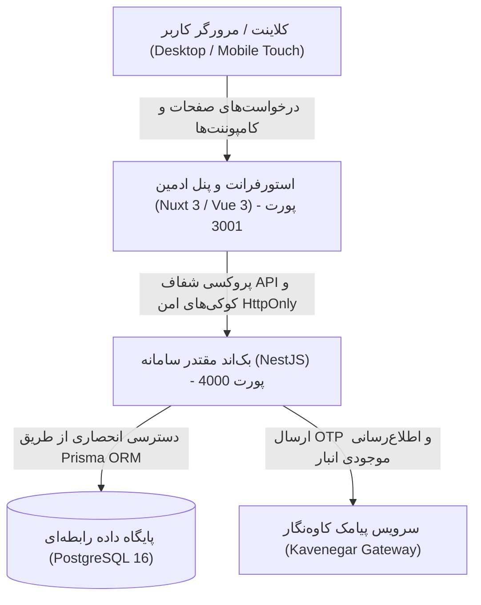

# معماری یکپارچه سامانه ویپ‌لب (VAPELAB Architecture)

این سند معماری نهایی، مرجع و تولیدی (Production-Ready) کل پلتفرم فروشگاهی ویپ‌لب را تشریح می‌کند.

---

## ۱. نمای کلی سیستم (System Overview)

پلتفرم ویپ‌لب از سه لایه اصلی تشکیل شده است:

---

## ۲. بک‌اند انحصاری و مقتدر (Authoritative Backend: NestJS)

- **فریم‌ورک:** NestJS نسخه ۱۰ با ساختار ماژولار و TypeScript.
- **مسئولیت‌ها:**
  - تنها نقطه انحصاری اجرای تمام قوانین تجاری، احراز هویت، انبارداری و تراکنش‌های مالی.
  - هیچ لایه دیگری (از جمله Nitro) حق اتصال مستقیم به پایگاه داده یا اجرای منطق موازی تجاری را ندارد.
- **ماژول‌های بک‌اند:**
  1. `AuthModule`: ورود و ثبت‌نام فقط بر اساس نام کاربری/ایمیل و رمز عبور (بدون OTP اجباری لاگین)، هش‌کردن رمزها با `bcryptjs`، صدور کوکی امن HttpOnly به نام `vapelab_token` با محافظت کامل در برابر CSRF.
  2. `ReservationsModule`: رزرو اتمیک ۱۰ دقیقه‌ای موجودی انبار مستقیماً در PostgreSQL با استفاده از ترنزکشن‌های پایگاه داده.
  3. `OrdersModule`: ثبت سفارش منوط به احراز هویت مشتری، اعتبارسنجی رزرو فعال، اسنپ‌شات تغییرناپذیر نرخ کمیسیون، و کسر قطعی انبار فقط پس از تایید موفق پرداخت.
  4. `ProductsModule`: کاتالوگ محصولات، فیلترها، جستجو و کنترل موجودی.
  5. `CategoriesModule` و `BrandsModule`: دسته‌بندی‌ها و برندهای کالاها.
  6. `BannersModule`: اسلایدر و بنرهای صفحه اصلی فروشگاه.
  7. `SuppliersModule`: پرتال تأمین‌کنندگان با جداسازی کامل داده‌ها (Data Isolation) و به‌روزرسانی موجودی کالاهای تخصیص‌یافته.
  8. `SettlementsModule`: موتور تسویه‌حساب هفتگی تأمین‌کنندگان، کسر اتوماتیک کمیسیون پلتفرم و ثبت اسناد دوبل حسابداری در `TransactionJournal`.
  9. `AdminModule`: مدیریت عملیات ادمین، آمار داشبورد (KPI)، تغییر وضعیت سفارش‌ها و رهگیری پستی مرسولات.
  10. `PaymentsModule`: مدیریت یکپارچه تراکنش‌های درگاه پرداخت، سرویس اختصاصی سندباکس زرین‌پال (`ZarinpalService`) با اتصال به REST v4، وریفای اتمیک، ثبت سوابق مالی و پشتیبانی از فال‌بک شبیه‌ساز پرداخت.
  11. `StorefrontModule`: نشانی‌های ذخیره‌شده کاربران، اعتبارسنجی کدهای تخفیف، ثبت نظرات، خبرنامه و فرم تماس.

---

## ۳. معماری پایگاه داده و اورام (Prisma ORM & PostgreSQL)

- **دیتابیس:** PostgreSQL 16 انحصاری (`vape_lifestyle_db`).
- **اورام:** Prisma ORM نسخه 6.19.3.
- **حذف Drizzle:** ماژول Drizzle و فایل‌های موازی آن به طور کامل از چرخه عملیاتی حذف شده‌اند.
- **یکپارچگی شناسه‌ها و مبالغ:** تمام شناسه‌ها به صورت `Int` و کلیه مبالغ مالی بدون اعشار بر حسب تومان ایران (`IRT`) ذخیره می‌شوند.

---

## ۴. استورفرانت و پنل مدیریت مقتدر (Nuxt Storefront & Nuxt Admin)

- **چارچوب:** Nuxt 3 / Vue 3 / Vite.
- **پنل مدیریت پیش‌فرض و انحصاری:** پنل ادمین مستقر در `app/pages/admin-panel` با چیدمان `app/layouts/admin.vue` پنل رسمی و انحصاری سامانه است.
- **حذف پنل آنگولار:** پروژه قدیمی و زائد `/admin` که به صورت موازی با فریم‌ورک Angular وجود داشت به همراه وابستگی‌های مربوطه حذف شد.
- **حذف کدهای Next.js:** دایرکتوری قدیمی و بلااستفاده `src/` و فایل `next.config.ts` به طور کامل پاکسازی شدند.
- **پروکسی Nitro:** در `nuxt.config.ts`، تمام درخواست‌های `/api/**` به صورت شفاف به بک‌اند NestJS روی `http://127.0.0.1:4000/api/**` هدایت می‌شوند و کوکی‌های احراز هویت حفظ می‌گردند.

---

## ۵. امنیت و کنترل دسترسی بر پایه نقش (RBAC)

سه نقش سیستمی اصلی پیاده‌سازی شده‌اند:
1. `CUSTOMER`: ثبت سفارش پس از ورود، مدیریت نشانی‌ها، مشاهده تاریخچه خرید.
2. `ADMIN`: مدیریت کل محصولات، بنرها، آمار مالی، تایید واریزهای تسویه، تغییر وضعیت سفارش‌ها.
3. `SUPPLIER`: دسترسی اختصاصی به پرتال تأمین‌کننده (`/supplier`)، مشاهده فروش اقلام خود، به‌روزرسانی موجودی انبار کالاهای تحت مالکیت، و مشاهده صورت‌حساب‌های تسویه هفتگی.
