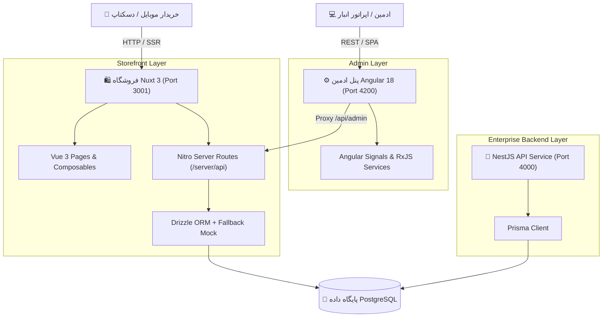
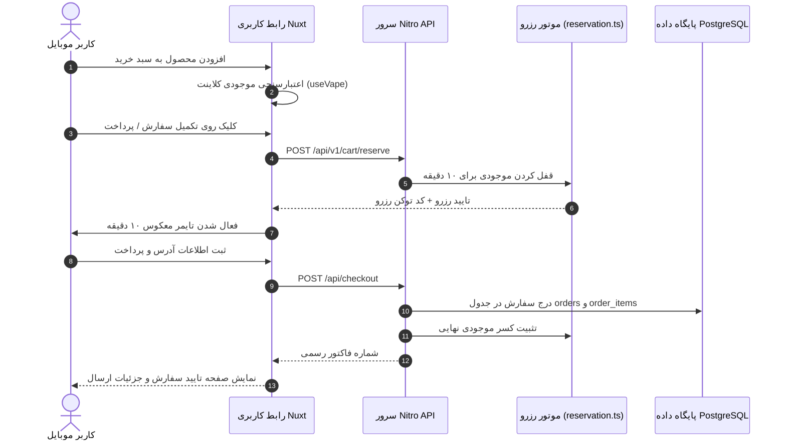

# 🏛️ مستند معماری فنی ویپ‌لب (VAPELAB Architecture)

## ۱. نمای کلی معماری (High-Level Architecture)

پروژه ویپ‌لب از یک معماری چندلایه و ماژولار بهره می‌برد که برای پاسخگویی به سرعت بالا در موبایل و مدیریت عملیاتی فروشگاه به ۳ بخش تفکیک شده است:

---

## ۲. لایه‌های سیستم به تفکیک

### ۲.۱. لایه فروشگاه (Storefront - Nuxt 3)
- **محل:** `/app`, `/server`, `/public`
- **فناوری:** Nuxt 3.16 + Vue 3 (Composition API) + Tailwind CSS v4 + Vite.
- **رندرینگ:** رندر هیبریدی (SSR برای SEO صفحات محصولات و دسته‌بندی‌ها + SPA/CSR برای سبد خرید و حساب کاربری).
- **مدیریت استیت (State Management):** 
  - سینگلتون پترن با Vue Composables (`useAuth`, `useVape`, `useReservation`, `useRestockAlerts`).
  - عدم استفاده از وابستگی‌های سنگین مانند Pinia در فرانت برای حفظ سبکی و زمان لود آنی در موبایل.
  - همگام‌سازی خودکار استیت‌های بحرانی با `localStorage`.
- **۳D و واقعیت افزوده:** اسکریپت رسمی `<model-viewer>` شرکت گوگل برای رندر سه‌بعدی سبک، سازگار با مرورگرهای موبایل سافاری و کروم.

### ۲.۲. سرور داخلی Nitro (`/server`)
- سرور بدون سرور (Serverless-ready) تعبیه‌شده درون Nuxt 3.
- **مسیرهای API:**
  - `/server/api/auth/*`: احراز هویت بدون OTP با پسورد و صدور سشن.
  - `/server/api/products/*`: دریافت کاتالوگ محصولات، مشخصات، فیلتر و ره‌گیری موجودی.
  - `/server/api/checkout.post.ts`: پردازش سبد خرید، محاسبه تخفیف و ایجاد سفارش.
  - `/server/api/ai/chat.post.ts`: موتور استنتاجی مشاور انتخاب طعم و نیکوتین.
  - `/server/api/admin/*`: اندپوینت‌های پردازش اطلاعات سفارشات، فاکتورها و آمار BI ویژه پنل ادمین.
- **اتصال دیتابیس:** Drizzle ORM با درایور استاندارد `pg`.
- **مکانیزم تاب‌آوری (Fallback Resilience):** در صورت عدم دسترسی به دیتابیس PostgreSQL یا آفلاین بودن سرور پایگاه‌داده، ماژول `fallbackData.ts` وارد مدار شده و فروشگاه بدون ارور ۵۰۰ با دیتاهای کاتالوگ محلی سرویس‌دهی می‌کند.

### ۲.۳. پنل مدیریت (Admin Panel - Angular 18 Standalone)
- **محل:** `/admin`
- **فناوری:** Angular 18 (Standalone Components، بدون نیاز به NgModules)، TypeScript 5.4، SCSS.
- **مدیریت حالت و جریان داده:**
  - **Angular Signals:** برای متغیرهای استیت محلی، فرم‌ها و وضعیت‌های کامپوننت.
  - **RxJS Streams:** برای مانیتورینگ جریان جستجو (`debounceTime`, `distinctUntilChanged`, `switchMap`) و اتصال به سرویس‌های دیتایی.
- **معماری داخلی پنل:**
  - `/admin/src/app/core`: اینترسپتورها (`auth.interceptor.ts`)، گاردها (`auth.guard.ts`)، مدل‌ها و سرویس‌های پایه.
  - `/admin/src/app/features`: ماژول‌های فیچر مستقل (داشبورد هوش تجاری، سفارشات، کالاها، احراز هویت).
  - `/admin/src/app/layout`: لایوت واکنش‌گرا با هماهنگی کامل موبایل (سایدبار پاپ‌آپ و نوار پایین صفحه).
  - `/admin/src/app/shared`: چارت اختصاصی تحلیلی SVG و پایپ‌های فرمت قیمت تومان.

### ۲.۴. بک‌اند سازمانی (NestJS API - `/backend`)
- **محل:** `/backend`
- **فناوری:** NestJS 11 + Prisma ORM 6 + Passport JWT + Swagger.
- **هدف معماری:** جداسازی منطق‌های سازمانی، پردازش‌های ناهمگام نوتیفیکیشن‌ها و وب‌هوک‌های درگاه‌های بانکی در محیط میکرو‌سرویسی.

---

## ۳. جریان داده سفارش و رزرو کالا (Order & Reservation Data Flow)

---

## ۴. استراتژی استایل‌دهی و تم تاریک نئونی (Design System)
- **پالت رنگی:** دارک نئونی لوکس (`#09090b` به عنوان پس‌زمینه اصلی، فسفری `#22c55e` برای المان‌های فراخوان اقدام CTA، فیروزه‌ای `#06b6d4` برای متالیک و بنفش `#8b5cf6` برای طعم‌های سالت).
- **فونت فارسی:** استفاده از فونت استاندارد **وزیرمتن (Vazirmatn)** در تمام سطوح فرانت و ادمین برای خوانایی کامل روی صفحه‌نمایش‌های کوچک.
- **Glassmorphism:** بهره‌گیری از `backdrop-filter: blur(12px)` برای شیت‌ها و هدر شناور.
